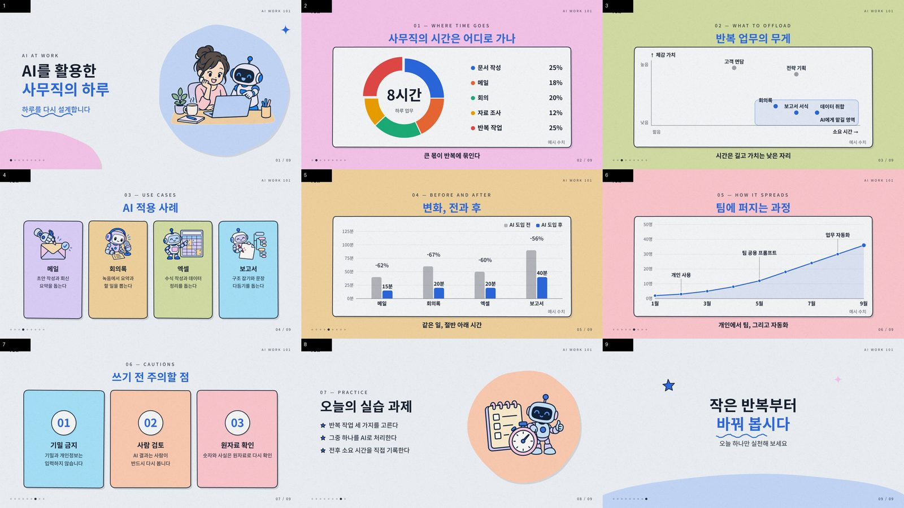
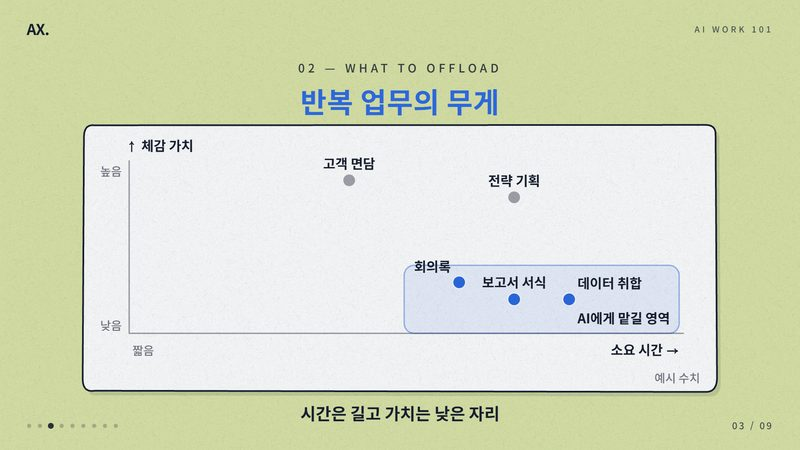
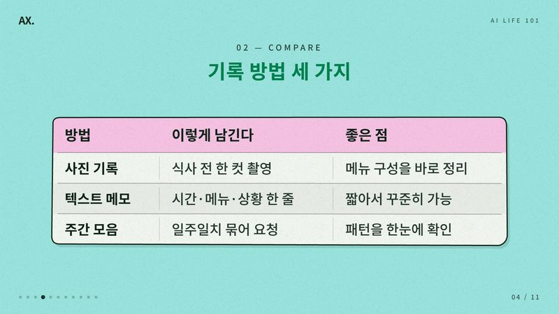
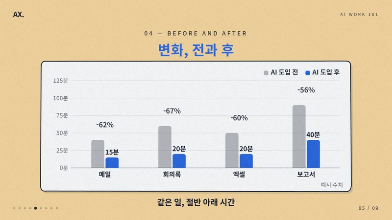
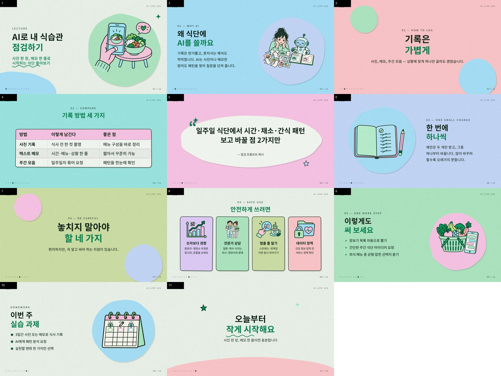
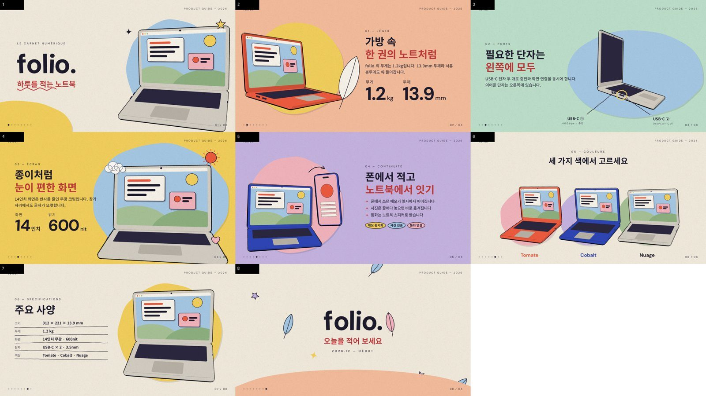

# motion-deck

**원자료를 넣으면 손그림 스타일의 내레이션 강의 영상이 나온다.**
Source material in, narrated hand-drawn lecture video out.

텍스트·PDF·PPT 같은 강의 자료와 기준 색 하나만 정하면, 대본 작성 → 일러스트 생성 → TTS 음성 → 말에 맞춘 애니메이션 → 자동 검수 → MP4까지 명령 하나로 만든다. 중간 결과물(스토리보드, 그림, 음성, 덱)은 모두 파일로 남아서 고친 부분만 다시 만들 수 있다.



<table><tr>
<td></td>
<td></td>
<td></td>
</tr></table>

---

## 무엇을 하나

- **명령 하나로 강의 영상**: `python md.py make projects/<이름>` → `lecture.mp4` + 자막(SRT) + 품질 리포트
- **말에 맞춰 움직이는 화면**: 내레이션에 큐 `[[c1]]`를 찍으면 해당 단어를 말하는 순간 제목·카드·표의 행·그래프 막대가 나타난다. TTS 음성의 실제 발화 시각을 음성인식으로 찾아 맞춘다(오차 0.1초 안팎).
- **새로 그리지 않고 재사용**: 표·카드·흐름도·그래프가 변형(variant)을 가진 컴포넌트로 준비되어 있고, 완성된 강의의 도식이 라이브러리에 쌓여 다음 강의의 참고가 된다.
- **기준 색 하나 → 팔레트 전체**: 배경 파스텔, 글자색, 강조색, 그래프 색까지 자동 생성. 글자 대비와 색각이상 구분을 계산으로 보장한다.
- **숫자는 한국어로 읽기**: 내레이션의 숫자는 모두 한국어로 풀어서 읽는다(9시 → 아홉 시, 240시간 → 이백사십 시간, 11/30(월) → 십일월 삼십일 월요일). 자막에는 숫자 그대로.
- **교육용 가독성 기본값**: 본문 40px(1080p), 넉넉한 줄 간격, 균형 줄바꿈, 28px 미만 글자 자동 경고.
- **자동 검수**: 텍스트 겹침, 화면 이탈, 실제 배경 픽셀 기준 대비, 작은 글자, 렌더 오류를 슬라이드마다 검사한다.
- **데이터 정직성**: 원자료에 수치가 없어 예시 수치를 쓰면 화면에 "예시 수치"가 표시되고, 내레이션이 그 사실을 밝히지 않으면 스토리보드 단계에서 막힌다.
- **HTML도 그대로 결과물**: 영상과 같은 내용이 오프라인에서 열리는 HTML 한 장으로도 나온다(키보드·클릭·스와이프로 넘김).

## 작동 방식

```
projects/<이름>/
  project.json   ← 제목, 기준 색, 목소리, 분량, 요구 사항(brief)
  sources/       ← md · txt · pdf · pptx · docx

  ① ingest      원자료 텍스트 추출
  ② storyboard  슬라이드별 템플릿 선택 · 빈칸 채우기 · 내레이션 · 큐         Claude (claude -p)
  ③ assets      개념 일러스트 병렬 생성 → 흰 배경 제거                        Codex 이미지 생성
  ④ deck        템플릿 펼치기 · 팔레트 · 배경 순환
  ⑤ narrate     TTS → 음성인식으로 큐 시각 정렬 → 음성 트랙 · 자막              Supertonic · faster-whisper
  ⑥ build · qa  HTML 한 장 + 자동 검수
  ⑦ render      브라우저 여러 개로 병렬 렌더(정지 구간은 복사) → MP4            Playwright · ffmpeg
  ⑧ report      영상 · 시트 · 싱크 · QA · 팔레트 · 소요 시간 한 페이지
```

LLM이 쓰는 단계는 ②뿐이고, 나머지는 같은 입력이면 같은 결과가 나오며 단계별로 캐시된다. 원고 한 줄을 고치면 그 슬라이드의 음성과 이후 단계만 다시 만든다.

## 빠른 시작

### 1. 설치

```bash
pip install -r requirements.txt
playwright install chromium
# 강의 영상 파이프라인
pip install supertonic faster-whisper numpy soundfile opencv-python PyMuPDF python-pptx
npm i -g @openai/codex      # 일러스트 생성 (로그인 필요)
# 스토리보드: Claude Code CLI(claude) 로그인 또는 ANTHROPIC_API_KEY
```
ffmpeg가 PATH에 있어야 한다. GPU는 필요 없다(음성인식은 CPU로 돈다).

### 2. 예제 덱 열어 보기 (설치 없이)

[`examples/folio/folio.html`](examples/folio/folio.html)을 브라우저로 연다. `←` `→` 이동, `F` 전체화면, `R` 다시 재생.

### 3. 강의 영상 만들기

```bash
mkdir -p projects/my-lecture/sources
cp 강의자료.md projects/my-lecture/sources/
```

```json
// projects/my-lecture/project.json
{
  "title": "AI로 내 식습관 점검하기",
  "color": "#2FA36B",
  "voice": "M1",
  "fps": 24,
  "length": "4min",
  "audience": "AI를 일상에 활용해 보고 싶은 직장인",
  "brief": "표를 1개 포함한다. 주의사항은 빠짐없이 넣는다. 마지막 직전에 실습 과제."
}
```

```bash
python md.py make projects/my-lecture
# → projects/my-lecture/build/lecture.mp4, report.html
```

| 필드 | 뜻 |
|---|---|
| `color` | 기준 색 하나. 팔레트 전체가 여기서 나온다 (`palette`로 일부 덮어쓰기 가능) |
| `voice` | Supertonic 목소리 `M1`–`M5`, `F1`–`F5` (`speed`로 속도) |
| `fps` | 렌더 fps. 강의는 24 권장 (기본 12) |
| `brief` | 스토리보드에 전달되는 요구 사항 — 장면 순서, 꼭 넣을 표·그래프 종류 등 |
| `font` | Google Fonts 고딕 이름 (기본 `Noto Sans KR`) |
| `brand`, `label` | 화면 왼쪽 위 로고 글자, 오른쪽 위 라벨 |

### 4. 고치고 다시 만들기

| 고칠 것 | 방법 | 다시 도는 범위 |
|---|---|---|
| 내레이션·화면 문구·수치 | `build/storyboard.json` 직접 수정 | 해당 슬라이드 음성 + 이후 단계 (약 3분) |
| 그림 하나 | `build/assets/<키>.png` 삭제 | 그 그림만 다시 생성 |
| 크기·간격·등장 방식 | `templates/lecture/_set.json` | 빌드·렌더 |
| 처음부터 다시 쓰기 | `--redo storyboard` (이전 버전은 `build/history/`에 백업) | 전체 |

실측(Windows 10, 16코어 CPU, 11장·약 3분 강의): 처음 실행 약 16분(스토리보드 3.5 · 그림 1.3 · 음성 3 · 렌더 3.5분), 수정 후 재실행 약 3.5분.

## 템플릿과 도식 컴포넌트

슬라이드는 레시피(`templates/lecture/*.json`)로 만든다. LLM은 레시피를 고르고 빈칸만 채우며, 좌표·색·등장 순서는 레시피가 정한다.

`cover` · `section` · `concept-left` / `concept-right` / `concept-hero` · `bullets-art` · `cards` · `flow` · `table` · `chart` · `quote` · `summary` · `ending`

구조가 있는 내용은 컴포넌트를 데이터와 `variant`만 바꿔 쓴다.

| 컴포넌트 | variant | 예 |
|---|---|---|
| 표 `table` | `compare` · `matrix`(✓✗△) · `before-after` · `steps` | 기록 방법 비교, 도구별 가능 여부, 전후 대비, 실습 순서 |
| 카드 `cards` | `icon`(일러스트) · `number`(큰 번호, 그림 생성 없음) | 역할 세 가지, 주의점 |
| 흐름도 `flow` | `linear` · `loop`(되돌아가는 연결) | 계획 → 실행 → 검수 →(반려)→ 재작업 |
| 그래프 `chart` | `donut` · `bar`(묶음·전후 증감) · `line`(단계 표시) · `scatter`(강조 영역) | 업무 시간 비중, 전후 소요 시간, 활용 인원 추이 |

각 컴포넌트에는 가독성 한도(열 수, 글자 수 등)가 있어서 넘치면 LLM이 스스로 고친다. 완성된 강의의 도식은 `library/<컴포넌트>/`에 저장되어 다음 강의 스토리보드에 예시로 들어간다. → [references/components/](references/components/README.md)

<table><tr>
<td></td>
<td></td>
</tr><tr>
<td align="center">강의 예: 표 · 번호 카드 · 일러스트</td>
<td align="center">쇼케이스 예: 3D 모델 · 지시선 · 손떨림(<code>boil: true</code>)</td>
</tr></table>

## 덱을 직접 쓰기 (파이프라인 없이)

`deck.json` 하나로 HTML 프레젠테이션을 만들 수도 있다. 텍스트 요소에는 좌표를 주지 않는다(레이아웃 컬럼에 자동으로 쌓인다). 좌표는 가로 1920×1080 기준.

```json
{
  "meta": { "title": "AI 교육 안내", "brand": "AX." },
  "slides": [
    { "layout": "text-left", "bg": "mint", "elements": [
      { "type": "kicker", "text": "01 — WHY" },
      { "type": "title", "lines": ["반복 업무는", "AI에게"], "accent": 1 },
      { "type": "bullets", "items": ["보고서 초안 작성", "회의록 정리", "데이터 요약"] },
      { "type": "blob", "x": 1400, "y": 560, "r": 380, "color": "sky" }
    ]}
  ]
}
```

```bash
python scripts/build.py deck.json -o out/deck.html
python scripts/capture.py out/deck.html --out out/shots --qa --portrait   # 시트 + 검수
```

내레이션을 붙이려면 슬라이드에 `"narration": "... [[c1]]반복 업무는 ..."`, 요소에 `"at": "@c1"`을 쓰고 `scripts/sync.py`를 거친다. 전체 필드는 [deck-schema.md](references/deck-schema.md), 명령 옵션은 [cli.md](references/cli.md).

## AI 에이전트와 함께 쓰기

이 폴더를 작업 디렉터리로 열면 각 도구가 규칙 문서를 자동으로 읽는다. 다른 곳에서 쓸 때는 폴더째 복사하면 된다(경로는 모두 상대 경로).

| 파일 | 읽는 도구 | 내용 |
|---|---|---|
| [AGENTS.md](AGENTS.md) | Codex CLI, Cursor 등 | 환경, 명령, 캐시 규칙, 컴포넌트 재사용, 런타임 수정 규칙, 품질 기준, 알려진 함정 |
| [CLAUDE.md](CLAUDE.md) | Claude Code | AGENTS.md를 불러오고 Claude Code 전용 지침 추가 |
| [SKILL.md](SKILL.md) | claude.ai Skills / Claude Code 스킬 | 덱 한 장을 만드는 워크플로 |

CLI가 PATH에 없으면 `CODEX_PATH`, `CLAUDE_PATH`, `CHROME_PATH`로 위치를 지정한다.

## 저장소 구조

```
md.py               파이프라인 오케스트레이터
pipeline/           ingest · storyboard · llm · assets · deck · palette · components · report
templates/lecture/  슬라이드 레시피 + _set.json(타이포 스케일·폰트·최소 글자 크기)
library/            완성된 강의에서 모은 표·카드·흐름도·그래프 예시
runtime/            캔버스 런타임 (src/ → npm run build → dist/motion-deck.js)
scripts/            build.py · capture.py · sync.py
references/         스키마 · 디자인 레시피 · 컴포넌트 · 명령어 레퍼런스
examples/           folio(쇼케이스) · lecture(내레이션 예제)
projects/           강의 예제 3개의 입력(project.json, sources/) — build/는 생성물이라 저장소에 없음
```

## 문서

| 문서 | 내용 |
|---|---|
| [references/cli.md](references/cli.md) | 모든 명령과 옵션, 문제 해결 |
| [references/deck-schema.md](references/deck-schema.md) | deck.json 전체 필드, 타이포 스케일, 내레이션·큐 문법 |
| [references/components/](references/components/README.md) | 표·카드·흐름도·그래프 컴포넌트와 규칙 |
| [references/design-playbook.md](references/design-playbook.md) | 슬라이드 레시피 |
| [references/extending.md](references/extending.md) | 런타임에 요소·레이아웃 추가 |
| [references/models.md](references/models.md) | 3D 모델 (프리셋, 도형 조합, GLB) |
| [references/pipeline.md](references/pipeline.md) | 멀티에이전트 구성 (Planner → Author → Builder → Inspector → Critic) |

## 라이선스 · 출처

- 이 저장소의 코드와 문서: [MIT](LICENSE)
- 런타임 번들에 [Three.js](https://threejs.org/)(MIT)가 포함되어 있다.
- 외부 도구(Supertonic, faster-whisper, Codex, Claude, Playwright, ffmpeg)와 폰트(Google Fonts, 주로 SIL OFL)는 각자의 라이선스를 따르며 저장소에 포함되어 있지 않다. 생성된 이미지·음성의 사용 조건도 각 서비스의 약관을 따른다.
- 그래프 색 검증 방식은 데이터 시각화 지침(categorical palette, CVD 검사)을 따랐다.
